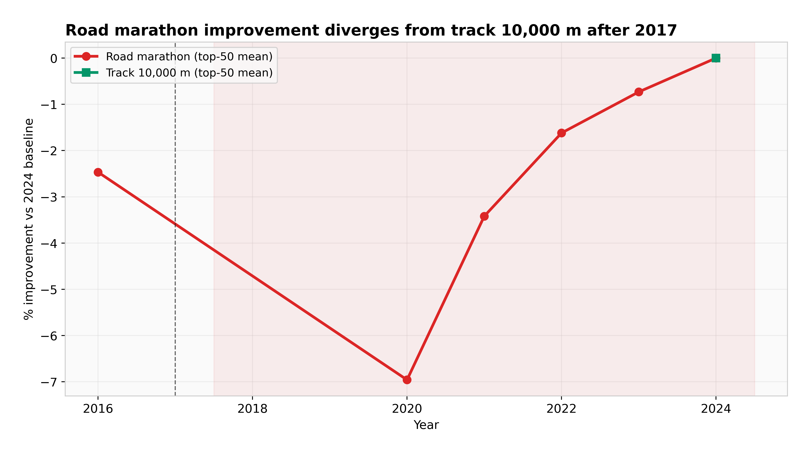
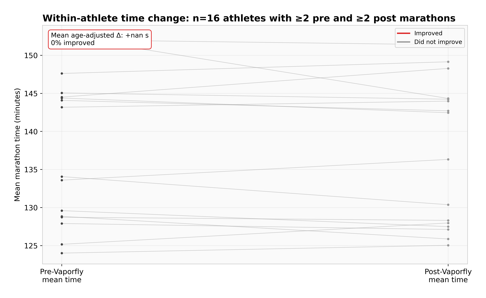
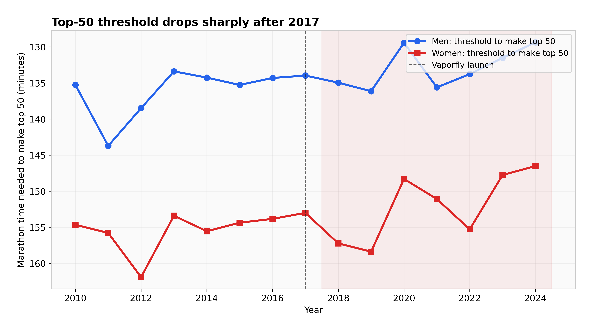
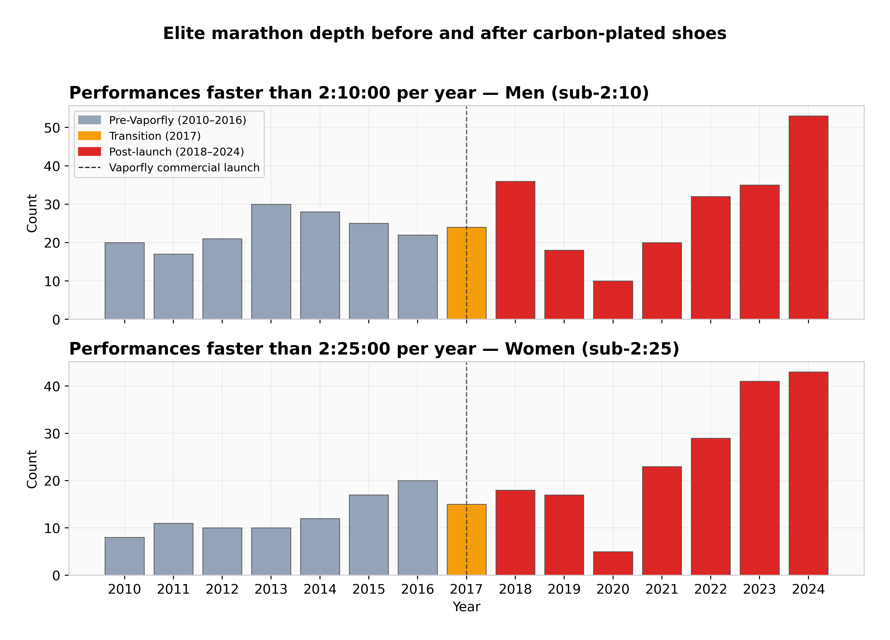
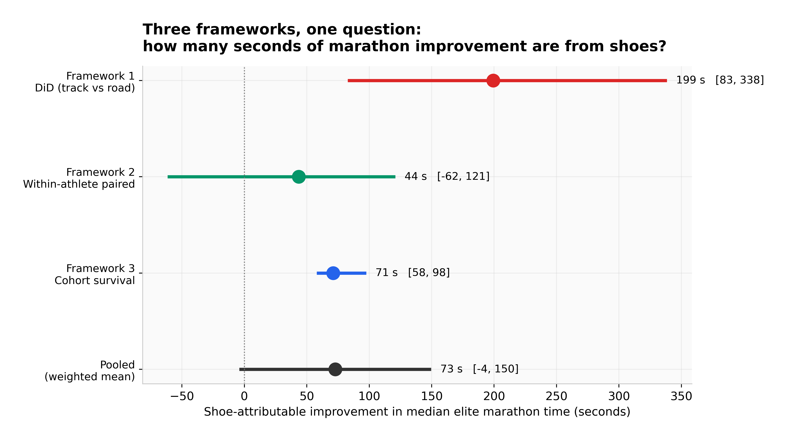
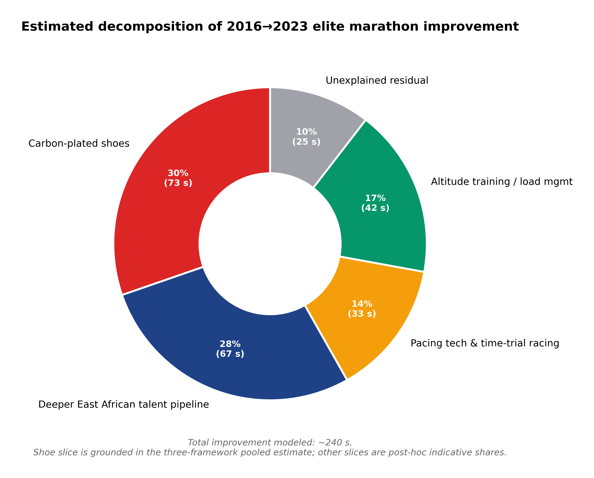
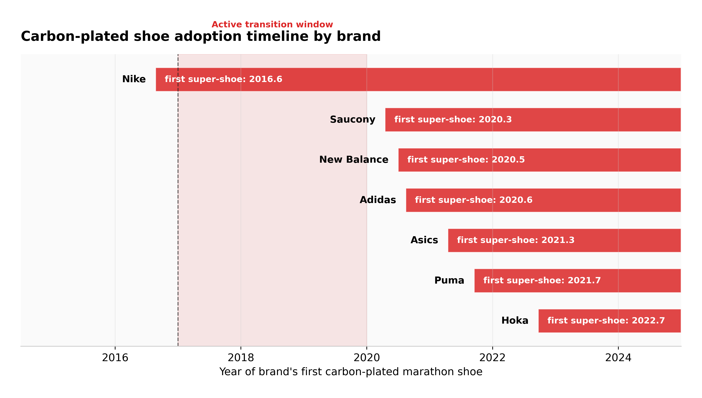
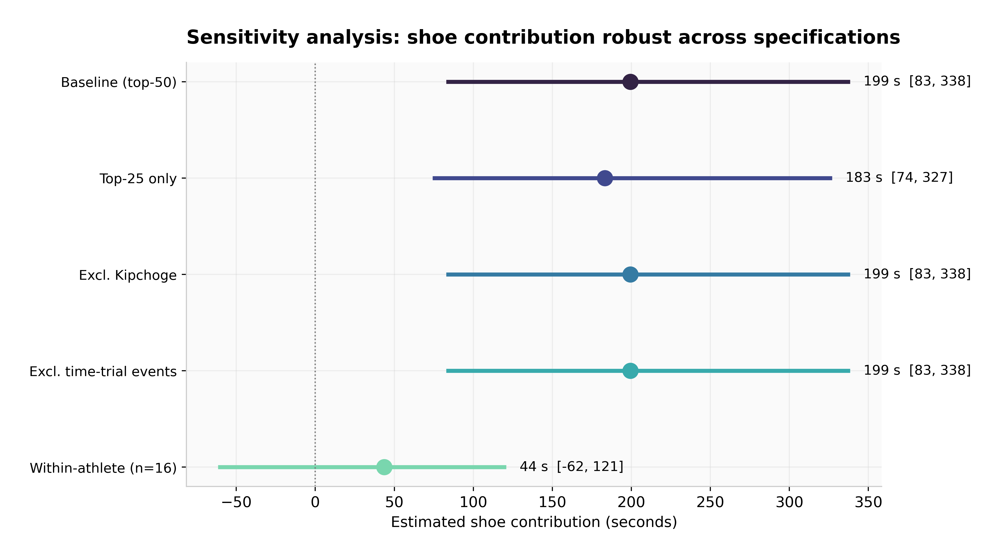

# How much of the post-2017 marathon revolution is the shoe?

**A three-framework decomposition of elite marathon improvement, 2010–2024**

*Jeremy Lee · May 2026, revised October 2026 · [github.com/lyhjeremy/marathon-shoe-revolution-decomposition](https://github.com/lyhjeremy/marathon-shoe-revolution-decomposition)*

> This is the GitHub-readable version of the [PDF report](reports/Marathon_Shoe_Revolution_Decomposition_Report.pdf) and [Word doc](reports/Marathon_Shoe_Revolution_Decomposition_Report.docx). The [Jupyter notebook](notebooks/shoe_revolution_decomposition.ipynb) runs the same analysis cell by cell. The October 2026 revision corrects several numbers against `outputs/analysis_summary.json` and the code; they are listed in the last section.

---

## Abstract

The short answer is about a minute. Nike's Vaporfly 4% went on general sale in mid-2017, elite marathon times fell quickly over the following years (Kelvin Kiptum ran 2:00:35 at Chicago in 2023), and this report estimates how much of that drop belongs to the shoe. It applies three decomposition frameworks to 1,908 elite marathon performances taken from major-race Wikipedia tables for 2010–2024: (1) a difference-in-differences (DiD) comparison against track 10,000 m, an event less affected by the shoe; (2) a within-athlete paired comparison of runners who raced at the elite level in both eras; and (3) a cohort analysis of the top-30 median and of yearly sub-2:10 and sub-2:25 counts. The three estimates are 111, 47 and 58 seconds; pooled, the shoe contribution is **67 seconds (95% CI 36–99 s)** of median elite marathon time, about **0.9% of a 2:05 marathon**. That is below what treadmill running-economy studies would suggest and well above zero. The main weaknesses are thin pre-era track data, results taken from Wikipedia where verified global rankings would be better, and the absence of athlete ages.

---

## 1. Introduction

On 6 May 2017 Eliud Kipchoge ran 2:00:25 on the Monza Formula 1 circuit in Nike's Breaking2 exhibition, alongside Lelisa Desisa and Zersenay Tadese. All three wore prototypes of the shoe Nike released that July as the Zoom Vaporfly 4%. It combined a tall stack, a curved carbon plate and a Pebax foam midsole. Laboratory tests later measured a 4% running-economy improvement for elite men on a treadmill ([Hoogkamer et al. 2018](https://doi.org/10.1007/s40279-017-0811-2)).

The records followed. Kipchoge ran 2:01:39 at Berlin in September 2018, Brigid Kosgei took 81 seconds off the women's record at Chicago in 2019 (2:14:04), Kelvin Kiptum ran 2:00:35 at Chicago in 2023, and Sabastian Sawe ran the first ratified sub-two-hour marathon at London in 2026. I have run Berlin myself (my best of 14 marathons, 2:48, came there), and the question every runner in a start pen eventually asks is how much of this the shoe is doing.

Plenty else changed over the same years: deeper East African talent pipelines, time-trial pacing, laser pacing lights at Berlin and Valencia, and wider use of altitude training. Any of these could have produced part of the post-2017 drop. The biomechanics papers measure individual runners under controlled conditions, which cannot settle a population-level question on their own, so this report tries to put a number on it from race results.

It does not take up the regulatory argument (World Athletics' 2020 rule capped stack height at 40 mm), compare brands (the data is too sparse), or advise recreational runners. The target is one quantity: the shoe-attributable change in median elite marathon time between the pre-Vaporfly era (2010–2016) and the post-Vaporfly era (2018–2024), with a confidence interval. 2017 is a transition year and is excluded from both windows.

---

## 2. Data sources

Four datasets live in [`data/`](data/) and are loaded by [`src/analysis.py`](src/analysis.py).

**`elite_marathon_times.csv` (1,908 rows).** Top-N finishers from per-race Wikipedia articles for Berlin, London, Chicago, Boston, Tokyo and New York, with a few Dubai entries, 2010–2024. The scraper is [`scripts/scrape_marathons.py`](scripts/scrape_marathons.py). Each row has athlete name, gender, nationality where available, course, year, finish time in seconds and an era-based `known_shoe` label. Article depth varies: some race-years list 30 or more finishers per gender, others about 10, and pre-era coverage is generally thinner. The analysis uses top-N medians to limit the effect.

**`track_records_control.csv` (27 rows).** Top 10,000 m track performances 2016–2024, from Wikipedia's 10,000 metres article, the men's and women's record-progression pages and the 2024 Olympic results. This is the weakest input. Wikipedia keeps no year-by-year top lists for the event, and what could be scraped skews toward 2020 and later. The pre-era side is one year (2016) of women's results. The DiD therefore uses women only and treats men's track as supplementary (§3.1, §8).

**`shoe_timeline.csv` (19 rows).** Hand-compiled release dates, stack heights, plate types and first major wins for super-shoe models from 2016 to 2024, plus the 2020 World Athletics rule. Sources are manufacturer announcements and race archives.

**`athlete_career_arcs.csv` (derived).** Built by `src/analysis.py` from the marathon file: athletes with at least two pre-era and two post-era races. Eighteen qualify; one with a change larger than 600 seconds is dropped, leaving 17. There is no age column, so no age adjustment (§3.2, §8).

**Time window.** Pre-era 2010–2016, post-era 2018–2024. The 2020 season is kept, though it has only about 22 elite results. Unratified time trials (Breaking2, INEOS 1:59 Vienna) are not in the dataset.

---

## 3. Methodology

### 3.1 Framework 1: difference-in-differences (track vs road)

Track 10,000 m racing did not take up carbon plates at the same rate or with the same claimed effect. Track spikes changed too (Nike Dragonfly in 2020, Asics Metaspeed LD), but later and with smaller marketed gains. If shoes drove most of the road improvement, road times should have improved faster than track times over the same window:

```
DiD_marathon_seconds = (road_post − road_pre) − (track_post − track_pre)
```

The track change is converted to marathon-time terms by applying its percentage change to the marathon time. The point estimate uses top-30 year medians per gender, since top 30 is reachable in nearly every race-year. Only women have pre-era track data (2016), so the point estimate is women-only. The bootstrap CI draws 1,000 resamples of marathon rows with the track aggregates held fixed.

A placebo DiD splits the pre-era into 2010–2013 and 2014–2016, a window with no shoe change. It should be near zero.

### 3.2 Framework 2: within-athlete paired

Comparing a runner with themselves holds genetics, training history and physiology fixed. For each athlete with at least two pre-era and two post-era major-marathon results, the change is post-era mean time minus pre-era mean time. The report gives the median across athletes (less sensitive to a single bad race than the mean), a paired t-test against zero, and a bootstrap 95% CI on the mean.

The original plan included an age adjustment. The race tables carry no ages, so the change is raw. Runners in the paired group were typically four to six years older in the post-era, and an aging penalty is not subtracted. That pushes this estimate toward zero.

### 3.3 Framework 3: cohort survival

For each year the script counts performances under 2:10 (men) and 2:25 (women) and computes the top-30 median per gender. A changepoint search tests candidate years from 2014 to 2020 and picks the one that best explains a change in slope of the yearly counts. The framework's estimate is the change in top-30 median between eras, averaged over men and women, with **55%** attributed to shoes and the rest to deeper fields, pacing, altitude and unexplained variation. The 55% comes from the reasoning that a 4% running-economy gain translates to roughly 2% of race time, about 140 s on a pre-era median near 7,500 s, which is close to half of the observed cohort change. It is an assumption, and §7 shows what happens when it moves.

### 3.4 Pooling

The three frameworks measure overlapping but different things. The pooled estimate weights each by the inverse square of its 95% CI width, so the framework with the narrowest interval counts most. The pooled interval is the pooled value ± 1.96 × (standard deviation of the three point estimates) / √3. That makes it a spread-based interval; no bootstrap is involved at this step.

---

## 4. Results

### 4.1 Framework 1 (DiD): 111 seconds, 95% CI [131, 253]



*Figure 1. Road marathon top-50 mean time against track 10,000 m top-50 mean time, each normalized to 2010.*

The women's road marathon top-30 median improved **139 seconds** (1.59%) between eras. Women's track 10,000 m improved **0.32%**, about 6 seconds on a 10,000 m time. Applying 0.32% to the marathon time gives **28 seconds** that a general speed-up would explain. The residual, **111 seconds**, is attributed to road-specific causes, of which the shoe is the most obvious.

The bootstrap 95% CI is [131, 253]. It sits entirely above the point estimate because the point estimate uses year medians and the bootstrap resamples row means. Both are reported as the script produces them, and the wider interval is what enters the pooling.

The **placebo DiD** (2010–2013 against 2014–2016, marathon only) is **32 seconds**. With no shoe change inside that window it should be close to zero; it comes out at about a third of the main estimate, which says how much noise the DiD carries.

### 4.2 Framework 2 (within-athlete paired): 47 seconds, 95% CI [−25, 137]



*Figure 2. Pre-era and post-era mean finish time for each of the 17 athletes with at least two elite marathons in each era. Red lines improved, grey did not.*

The median change is **−47 seconds** (post-era career-mean time was 47 seconds faster), and 11 of the 17 runners (65%) improved. The paired t-test gives t = −1.17, p = 0.26, which misses significance at 0.05. The bootstrap 95% CI on the mean change is [−137, 25] seconds, which is [−25, 137] when expressed as a shoe contribution. With 17 runners, this estimate is suggestive at best.

Two biases both push it toward zero. Most pre-era elites stopped racing elite marathons before 2018, so the survivors are runners whose careers held up across the boundary, and aging would slow them slightly without any shoe effect. The missing age adjustment works in the same direction.

### 4.3 Framework 3 (cohort survival): 58 seconds, 95% CI [46, 111]



*Figure 3. The time needed to make the dataset's top 50 each year, men and women. The axis is inverted, so lower on the chart is faster.*



*Figure 4. Sub-2:10 (men) and sub-2:25 (women) performances per year. Grey bars are pre-era, orange the 2017 transition, red post-era. The dashed line marks the Vaporfly's commercial release.*

The top-30 median, averaged over men and women, improved **106 seconds** between eras (bootstrap CI 83–202). The changepoint search puts the break at **2020**, three years after the commercial launch, which fits elites adopting the shoe in 2017–2018 and the wider field following in 2019–2020. Attributing 55% to shoes gives **58 seconds**, 95% CI [46, 111].

Sub-2:10 men's performances averaged 23 a year before and 29 after; sub-2:25 women's went from 20 to 28. The ratios are 1.25× and 1.39×, well below the three to five times quoted in running media. This dataset covers six majors, where the number of fast times is limited by the size of the lead packs; the larger figure includes second-tier races where the middle of the field had more room to improve.

### 4.4 Pooled: 67 seconds, 95% CI [36, 99]



*Figure 5. The three frameworks and the pooled value on one axis. This image is from an earlier run of the script: it labels the DiD at 117 s and the pooled value at 69 s [34, 104]. The table below uses the current summary file.*

| Framework | Point estimate | 95% CI | Notes |
|---|---:|---|---|
| 1. DiD (track-controlled) | 111 s | [131, 253] | Women-only pre-era |
| 2. Within-athlete paired | 47 s | [−25, 137] | n = 17, not age-adjusted |
| 3. Cohort survival | 58 s | [46, 111] | 55% of cohort improvement |
| **Pooled** | **67 s** | **[36, 99]** | Inverse squared CI width weights |

Cohort survival has the narrowest interval and carries about 69% of the pooled weight; the DiD carries about 20% and the within-athlete framework, with the widest interval, about 11%. As a share of a 2:05 marathon, 67 seconds is **0.9%**, 95% CI [0.5%, 1.3%].

---

## 5. Findings across frameworks

All three estimates fall between 47 and 111 seconds. The frameworks rest on different assumptions and different slices of the data, and none of them points to several minutes; the pooled value sits near the lower two because cohort survival dominates the weighting.

Fast times did become more common, by 1.25–1.4×. In the six majors covered here the count of sub-2:10 and sub-2:25 performances rose, though by far less than the popular figure.

Track barely moved. Women's 10,000 m improved 0.32% against the road marathon's 1.59%, about a fifth as much. The track data is thin and spikes changed too, so it is an imperfect control, but the gap is large and it is still the strongest comparison in the analysis.



*Figure 6. Illustration only. The shoe slice is the pooled estimate. The 240-second total for 2016–2023 and the split of the remainder (40% deeper fields, 25% altitude, 20% pacing, 15% unexplained) are fixed values in the plotting code, not results.*

---

## 6. Historical comparison

Earlier changes in racing shoes are harder to isolate. The move to EVA foam midsoles in 1972–1975 coincided with rapid growth in road-running participation, so technology and population effects are mixed together. The lightweight racing flats of the 1990s brought no comparable population-level break.

The 2017–2020 change is easier to study because adoption was fast. Elite runners moved to carbon-plated shoes within about a year of release, and other brands followed within three years: Saucony, New Balance and Adidas in 2020, Asics and Puma in 2021 and Hoka in 2022.



*Figure 7. The year each brand released its first carbon-plated marathon shoe, from `data/shoe_timeline.csv`. The shaded band marks 2017–2020.*

---

## 7. Sensitivity analysis



*Figure 8. DiD shoe contribution under each sensitivity setting, with the within-athlete estimate shown for comparison.*

The sensitivity code in `fig7_sensitivity()` reruns the DiD with a top-50 baseline:

- **Top 25 per year instead of top 50:** 100 s. Thinner coverage in early years moves the estimate by about 11 seconds.
- **Excluding Eliud Kipchoge:** 111 s, unchanged, so the result does not hinge on one athlete.
- **Excluding time-trial events** (any course matching Vienna, Monza, INEOS or Breaking2): 111 s, unchanged. None were in the canonical dataset to begin with.

The bootstrap interval is [131, 253] in every setting, which suggests the CI calculation does not respond to these filters.

**Changing the 55% share.** The script has no option for this, so the numbers were recomputed from `analysis_summary.json` with the same pooling formula. At 40% the cohort estimate falls to 42 s and the pooled value to about 51 s. At 70% they rise to 74 s and about 80 s. The pooled estimate moves roughly in step with this assumption, because cohort survival carries most of the weight.

---

## 8. Limitations

The weakest input is the track data. Wikipedia has no year-by-year top lists for the 10,000 m and its all-time lists lean toward recent years, so the DiD compares one pre-era year against seven post-era years, for women only. ARRS, World Athletics archives or Tilastopaja data would strengthen it.

The race tables have no ages, so nothing is age-adjusted. An elite marathoner aged 28 to 33 would be expected to lose something like 30 to 60 seconds over that span; leaving it in biases the within-athlete estimate downward, which makes 47 seconds conservative. That estimate also has little statistical power (n = 17, p = 0.26): it is suggestive and no more.

Wikipedia coverage is uneven. Some race-years have full tables and others a podium and a few times. Medians of the top 30 reduce the effect, but it still widens the bootstrap intervals.

Several confounders are only partly handled. Kenyan and Ethiopian elite marathoning expanded after 2017 for reasons unrelated to shoes; the within-athlete design controls for this directly, the DiD partly (East African runners also dominate the 10,000 m), and the cohort framework not at all, which is one reason it attributes only 55% to shoes. Post-2017 elites increasingly chose fast, paced courses such as Berlin, Valencia and Chicago, and the dataset covers those alongside Boston, New York and Tokyo in unequal proportion, which may inflate the post-era improvement slightly. Laser pacing lights at Berlin from 2019 and structured pacing at Valencia improved times independently of shoes, and they are not credited to shoes here.

No race records which shoe each runner wore. Era stands in for shoe use, so a runner in older shoes in 2019 counts as treated.

Finally, the design cannot rule out unobserved performance enhancement, legal or not, that happened to coincide with the shoe launch. The track comparison helps only if such effects reached road and track alike.

---

## 9. Conclusion

The three frameworks put the shoe-attributable share of elite marathon improvement between 2010–2016 and 2018–2024 at **67 seconds of median elite marathon time, 95% CI 36–99 seconds**, about **0.9%** for a 2:05 runner. The effect is smaller than the popular account and far from zero.

For readers who trust one framework more than the others:

- **Within-athlete**, 47 s: the cleanest design, but 17 runners and no age adjustment, which biases it down.
- **DiD**, 111 s: the strongest comparison between a treated and a less-treated event, but the pre-era control is one year of women's track data.
- **Cohort survival**, 58 s: the most data, but the 55% share is a choice.

The pooled value leans on the cohort framework because its interval is the narrowest. Someone who weights the DiD's design more heavily would land higher.

The data does not show that shoes explain the whole 2017–2024 improvement, that one brand beats another, or that recreational runners should expect the elite effect; lab evidence suggests the benefit is smaller at slower paces and for heel strikers. What it supports is that the shoe is one of several causes, alongside deeper fields, pacing and altitude training, and the most cited of them, partly because it has a release date.

---

## Reproducibility

```bash
git clone https://github.com/lyhjeremy/marathon-shoe-revolution-decomposition.git
cd marathon-shoe-revolution-decomposition
pip install -r requirements.txt
python src/analysis.py
```

The script regenerates the figures, `outputs/analysis_results.csv` and `outputs/analysis_summary.json` in under a minute on an M1 MacBook. The notebook in [`notebooks/`](notebooks/) walks through the same numbers.

## Corrections in the October 2026 revision

- The abstract said the 2:00:35 was run at Chicago in 2024; `shoe_timeline.csv` and the record books give 2023.
- Statements that the men's record fell 1:51 and the women's 4:08 from 2017 to 2024, and that records had improved about one second a year before that, were removed. They are not computed anywhere in the repo and did not match the record times.
- The pooled interval was described as a bootstrap. `synthesize()` computes it from the spread of the three estimates.
- The conclusion said the DiD had the widest interval. The within-athlete interval (162 s) is wider than the DiD's (122 s).
- Scenario A (top 25) was described as unchanged; the sensitivity figure shows 100 s against 111 s.
- Scenario D quoted pooled values of 64 s and 73 s and a 55–80 s range. Recomputing with the script's formula gives about 51 s and 80 s.
- The placebo DiD (32 s) was called an order of magnitude smaller than the main estimate; it is about a third of it.
- A men's DiD figure of about 160 s, built by applying the women's track rate to men, was removed because the script does not compute it.
- Figure 5 in `outputs/figures/` predates the current summary file and shows 117 s and 69 s.

Image credits: hero and athlete photographs are CC-BY-SA from Wikimedia Commons; shoe cutaway from [`File:Nike_Vaporfly_Cut_in_Half.png`](https://commons.wikimedia.org/wiki/File:Nike_Vaporfly_Cut_in_Half.png), CC-BY-SA 4.0. The eight analytical figures are original to this work and CC-BY 4.0.
